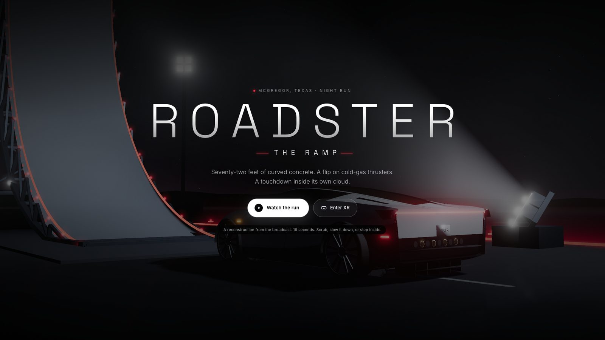
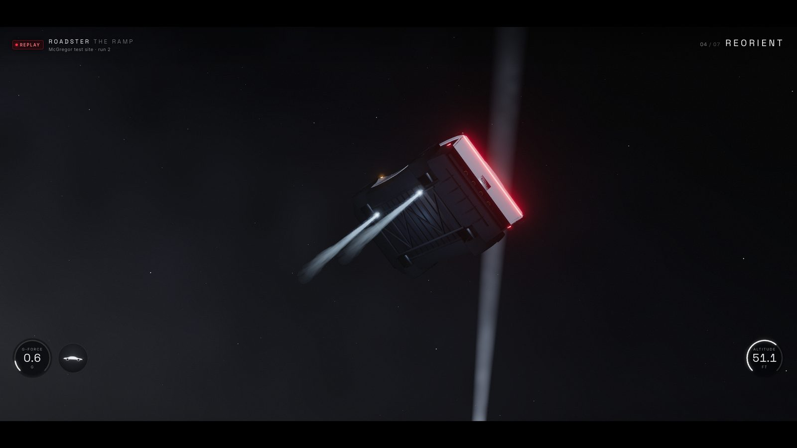
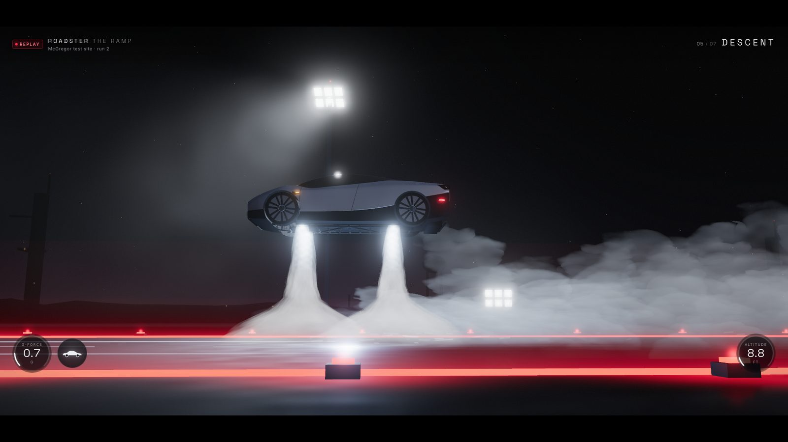
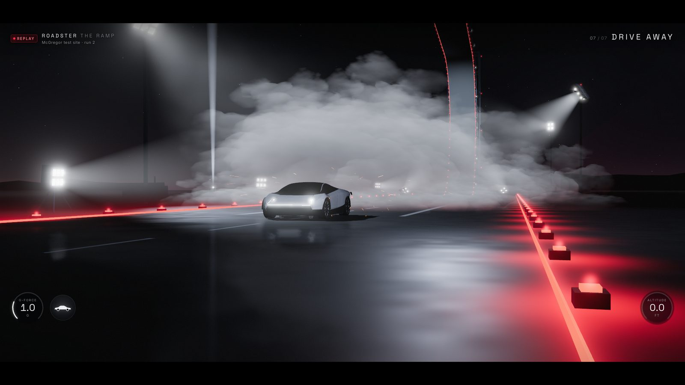

# Roadster: The Ramp

A WebXR recreation of the ramp stunt from Tesla's 2026 Roadster event. The car climbs a 72-foot curved ramp, leaves the overhang upside down, rolls upright on cold-gas thrusters and lands inside its own vapor cloud. You can watch it in the browser or step into it in VR.

It is built with [IWSDK](https://iwsdk.dev) (Meta's Immersive Web SDK, on Three.js). The car's path and the ramp's shape are measured from the public event footage; the car, the thruster firing and the set are rebuilt from that evidence. The separate fleet jump from the same event is not included.

This is an independent fan project, not affiliated with or endorsed by Tesla. See [NOTICE.md](NOTICE.md).









## Quick start

You need Node.js 20.19+, 22.12+ or 24+ (see `.nvmrc`).

```sh
npm install
npm run dev
```

`npm run dev` starts the IWSDK-managed dev server and opens a browser window. To use your own browser, open <https://localhost:8084/> and accept the local development certificate warning. Stop the server with `npm run dev:down`.

To try it on a headset (for example Meta Quest), run `npx @iwsdk/cli dev status`, open one of the listed network URLs on a headset on the same Wi-Fi, and accept the certificate warning. See IWSDK's [Testing Your Experience](https://iwsdk.dev/guides/02-testing-experience.html).

Other commands:

| Command | What it does |
| --- | --- |
| `npm run typecheck` | TypeScript check |
| `npm run build` | Production build into `dist/` |
| `npm run preview` | Serve the production build |
| `npm run verify:runtime` | Node-side checks of the replay track, effects and config (CI runs typecheck, build and this on every push) |

## Controls

| Input | Action |
| --- | --- |
| Space or Enter (title screen) | Start |
| Space | Play / pause |
| R | Restart |
| S | Toggle 1x / 0.25x speed |
| 1–3 | Camera: Ground (a fixed vantage beside the lane that follows the run, like the broadcast), Mounted (a rig fixed behind the car that rolls with it), Drone (a loose follow from the air) |
| Left / Right arrows | Step back / forward half a second |
| Timeline | Drag to scrub |
| **Enter XR** | Start an immersive VR session |

In XR, the control panel stays in the world, your head controls the camera, and IWSDK's standard locomotion is enabled.

## How it was built

**Reconstruction.** The ramp's rails were digitised in the main broadcast camera and in Tesla's wide overhead clip. A ramp profile and both cameras were fitted together, and the car's contact path was solved along that profile, giving a timed position and attitude track (`references/roadster/reconstruction/reconstruction.json`). Scale, unobserved depth, the edited clip's timing and the exact touchdown are uncertain, and the drive-away tail is extrapolated. An independent measurement review scored reliability 7/10 and motion plausibility 8/10. See [references/roadster/reconstruction/README.md](references/roadster/reconstruction/README.md) and the [data contract](references/roadster/reconstruction/DATA_CONTRACT.md). The source footage and stills are not distributed; the JSON measurements are. [VIDEO_UNDERSTANDING.md](VIDEO_UNDERSTANDING.md) indexes what each part of the broadcast shows.

**The car.** `public/models/roadster.glb` is modelled from scratch in Blender by Python scripts. The body is defined by its character lines, then cut into real panels with gaps (hood, fenders, doors, quarters, canopy and side glass, fascia, tail, diffuser, nozzles, wheels and lamps). The wheels and nozzle anchors are separate nodes. See [art/roadster/model-v6/README.md](art/roadster/model-v6/README.md). `art/roadster/model/` and `art/roadster/model-v5/` are earlier attempts, kept for their scripts.

**Thrusters.** A frame-by-frame study of the broadcast, its replay angle and the overhead edit shows the car leaving the lip inverted and rolling about its long axis. Four floor nozzles fire one side to start the roll and the other to stop it, then all four arrest the fall, while two side thrusters at the front bumper corners pulse alternately to hold the car's heading. `tools/thrusters/solve_thrusters.py` turns this into per-nozzle thrust with an inverse-dynamics solve and writes `src/data/thrusters.json`. See [tools/thrusters/README.md](tools/thrusters/README.md).

**Film.** `tools/film/` renders a 1080p30 film, all at real time. It opens with one continuous shot and no cuts: an orbit around the parked car, a crane out to a fixed vantage point, then the whole run from there with a smooth pan and zoom (`make_plans.py` drives the app's camera through `window.roadsterFilmCamera`). Next come a few seconds of the broadcast with the reconstruction reprojected over it frame by frame (`annotate_cv.py`): SIFT/RANSAC camera registration, the fitted ramp, the solved car path, and the posed car box with its body axes, rolling through the flip with the physics-solved attitude, plus the firing nozzles, a roll dial and per-nozzle thrust. It ends with a first-person VR walk-up in which the car passes a few metres away. Frame capture (`capture-frames.mjs`, `capture-all.sh`) steps the replay clock exactly and recovers on its own from browser failures; `assemble.sh` does the edit and needs ffmpeg. The film is not in the repository because its middle segment shows Tesla footage. `annotate_cv.py` needs the local footage excerpt, and `assemble.sh` skips that segment without it.

## Project structure

```
iwsdk.config.json        project authority: scene, assets, components, XR features
index.html               page shell (title screen, HUD, controls)
src/
  index.ts               World.create() and system registration
  assets.ts              asset manifest (car GLB, ramp, set, effects, UI)
  components.ts          ECS component manifest
  replay-*.ts            replay track, camera, controls, effects and system
  shell.ts               browser HUD and title screen
  cinematic-renderer.ts  bloom and output passes
  scene-assets/          procedural ramp, stage, lights, backdrop and effects
  data/thrusters.json    solved thruster firing
public/
  scenes/                scene composition (JSON)
  models/roadster.glb    runtime car
  textures/vapor-lit.png procedural vapor atlas
  ui/replay.uikitml      in-XR control panel
references/roadster/     reconstruction data, indexes and the reference extractor
art/roadster/            car modelling scripts (model-v6 is current)
tools/                   reconstruction, thrusters, textures, film and verification scripts
artifacts/               review reports and the final film (large captures are not tracked)
```

New to the terms: XR is an immersive (VR/AR) session; an ECS (entity-component system) is how IWSDK organises scene objects and the code that updates them. IWSDK's [concepts](https://iwsdk.dev) cover both.

## Status

This is a finished experiment, not a polished product. Independent reviewer agents scored each iteration out of 10:

- **Car:** judged against renders of the AI turnaround it was traced from, it plateaued around 7.0–7.7. Judged strictly against Tesla's press photos it went from 5 to 6 after the headlamp notches, tail, wheels and side vents were rebuilt from those photos (nose 7, silhouette 7, recognisable from the front three-quarter). The main remaining gap is the tunnel-back rear, where the real rear glass sits sunk between the buttresses.
- **Whole app:** from about 3.5 before the overhaul to 6.5–7.0 in the final rounds. The browser shell and HUD scored about 7.5–8.2. The weakest parts are the flip-phase framing and the vapour cloud next to the real footage.

## Performance

Measured per frame on the dev build, counting every WebGL draw call (`tools/verification/render-budget.mjs` for the browser view, `xr-render-budget.mjs` inside an emulated XR session):

| | Draw calls | Triangles |
| --- | --- | --- |
| Browser, car airborne | about 120 | about 130k |
| Browser, car on the ground (with the wet-asphalt reflection pass) | about 175 | about 240k |
| XR, both eyes | about 170 | about 230–260k |

On a desktop (Apple M4 Pro) the replay holds a locked 60 fps with about 3.6 ms of JavaScript per frame, and the hot paths allocate nothing per frame. What keeps it there:

- **Car model.** The car is exported merged by material: 41 meshes instead of 146.
- **Shadows.** Only a silhouette proxy (the inner body and the tyres) casts its ground shadow. The shadow maps freeze while the car is airborne, since it is the only shadow caster.
- **Shaders.** The asphalt shader computes its wet mask once per pixel. The vapour shader skips its finest noise octaves in XR, and the sky draws last so hidden pixels are rejected early.
- **Vapour sorting.** The vapour billboards are sorted with an allocation-free native sort.
- **Browser view.** The HUD moves without forcing layout. The HDR post chain is capped at 1.5× device pixels.

Quest itself has not been measured. The expected costs there are fragment shading (clearcoat car paint, nine lights including two shadowed spots), and vapour and beam overdraw during the landing.

## Automation hooks

The film and verification tools drive the app through `window.roadster` (seek, play, view, intro), `window.roadsterFilmCamera` (a scripted camera pose, lens and exposure), `window.roadsterScene` and `window.roadsterRenderInfo`. They are installed on the dev server, or in a production build only when the URL carries `?automation`. Otherwise a deployed page exposes nothing (`src/automation.ts`).

## Licence and notice

Code is MIT-licensed; see [LICENSE](LICENSE). Files from the IWSDK scaffold keep their Meta Platforms MIT headers. [NOTICE.md](NOTICE.md) explains what third-party media is excluded and why, credits the source footage, and shows how to regenerate the reference package. Contributions are welcome; see [CONTRIBUTING.md](CONTRIBUTING.md).
